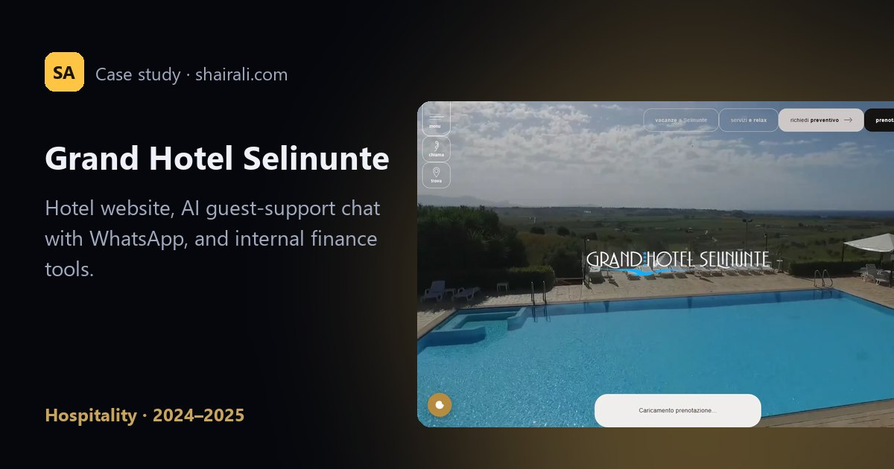
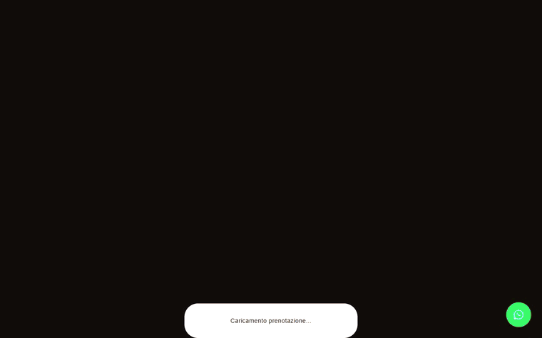
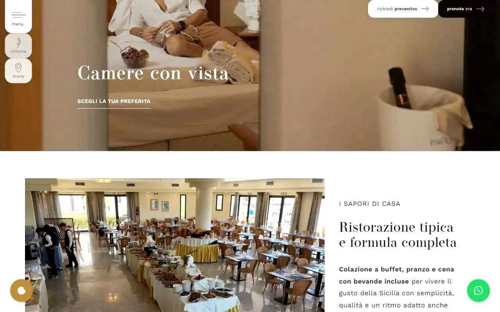
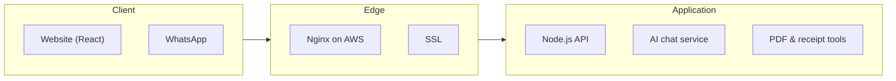
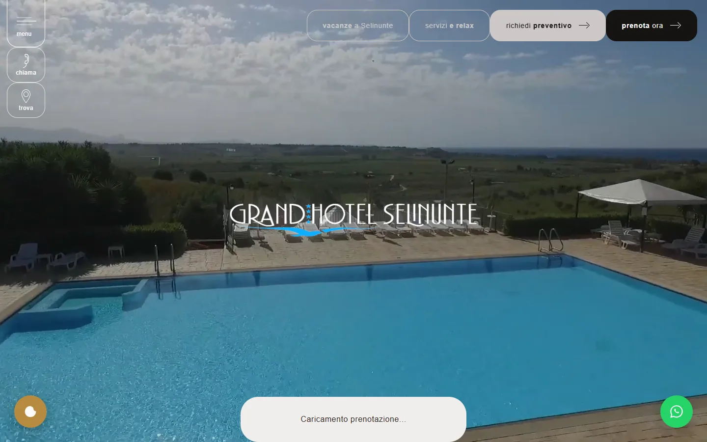
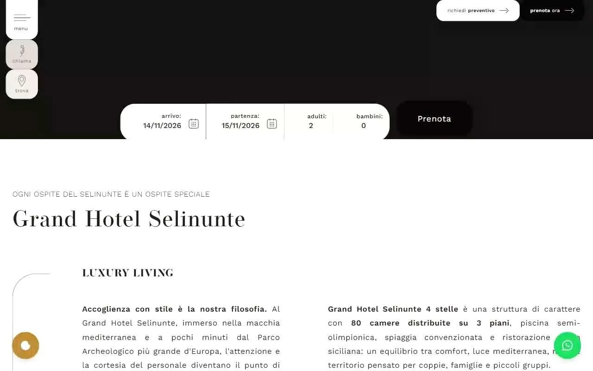
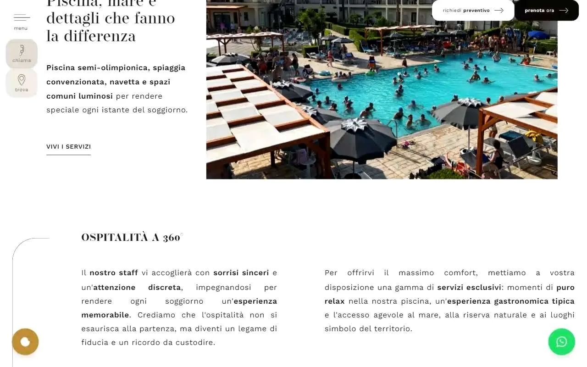
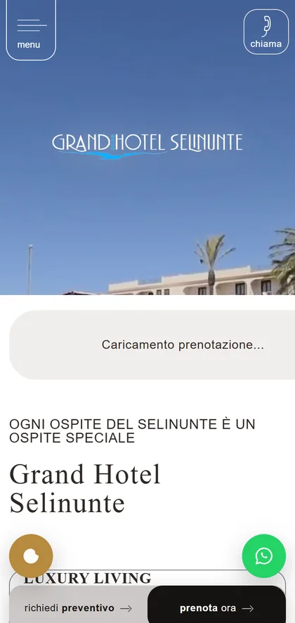

# Grand Hotel Selinunte

**Hotel website, AI guest-support chat with WhatsApp, and internal finance tools.**

 

Hospitality · Grand Hotel Selinunte · Sicily, Italy · 2024 – 2025

> [!NOTE]
> This repository is a **showcase**. The source code is private and belongs to the client, so this page documents what I built, how it works and the stack behind it. Screenshots are from the live product.

## Overview

The official website of a seafront hotel in Sicily, plus an AI chat assistant that answers guests on the web and WhatsApp, and in-house tools that automate quotes and receipts.

| | |
|---|---|
| **Role** | Full-stack developer: website, AI guest support & internal tools |
| **Client** | Grand Hotel Selinunte · Sicily, Italy |
| **Timeline** | 2024 – 2025 |
| **Live** | [grandhotelselinunte.com](https://grandhotelselinunte.com) |

## At a glance

<table><tr>
<td align="center" width="33%"><h3>3</h3>Products delivered</td>
<td align="center" width="33%"><h3>24/7</h3>AI guest support</td>
<td align="center" width="33%"><h3>2</h3>Support channels: web & WhatsApp</td>
</tr></table>

## The challenge

An international hotel gets the same guest questions all day, in several languages, across the website and WhatsApp, while the front office was still building quotes and receipts by hand. The hotel needed a modern website that converts, round-the-clock answers for guests and less manual admin work.

## What I built

I built and deployed the official website with a custom React frontend and a fully responsive booking journey. I then added an AI chat support system connected to WhatsApp for multilingual guest questions, plus internal tools that generate PDF quotes and receipts and calculate stay costs automatically.

## Key features

### Website and booking journey

A fast, fully responsive website with a custom React frontend, designed to turn visitors into direct bookings. It's deployed on AWS behind Nginx with SSL.

### AI chat support with WhatsApp

An AI assistant answers guest questions about rooms, services and bookings in several languages, on the website and over WhatsApp, around the clock.

### Internal finance tools

A cost calculator, a PDF quote generator and a receipt generator. Together they cut manual formatting and speed up replies to guests.

## Architecture

## Engineering highlights

- Production deployment on AWS virtual machines behind Nginx with SSL.
- Responsive, SEO-friendly pages built for hospitality search terms.
- AI assistant tuned to the hotel's own information, available on the web and on WhatsApp.

## Tech stack

| Area | Technologies |
|---|---|
| **Frontend** |   |
| **Backend** |   |
| **AI & messaging** |   |
| **Infrastructure** |    |

## Screens

<table>
<tr>
<td width="50%" valign="top"> Homepage hero with the hotel pool and countryside view</td>
<td width="50%" valign="top"> Luxury living introduction section</td>
</tr>
<tr>
<td width="50%" valign="top"> Rooms with a view and Sicilian dining sections</td>
<td width="50%" valign="top"> Pool, sea and services section</td>
</tr>
</table>

 Mobile

## About the developer

Designed, built and deployed by **[Shair Ali](https://shairali.com)**, a full-stack developer who owns products end to end: architecture, interface, API, data, payments, servers and CI/CD.

   

Have a similar project? [Get in touch](https://shairali.com/contact).
